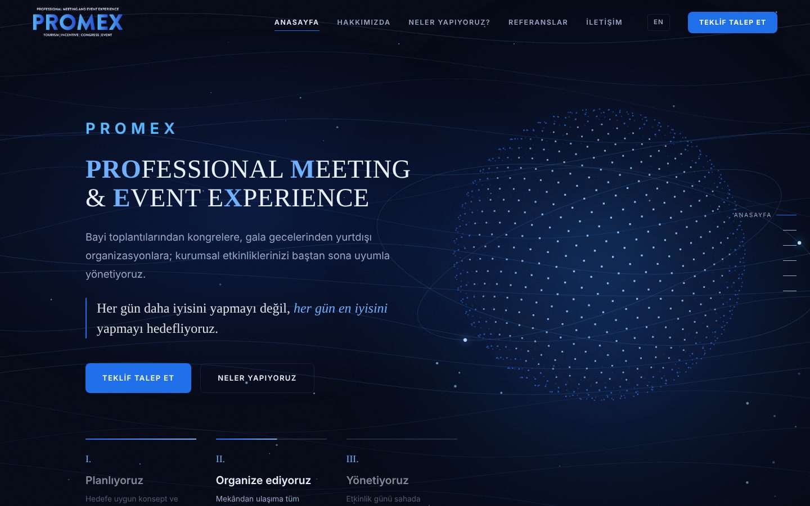
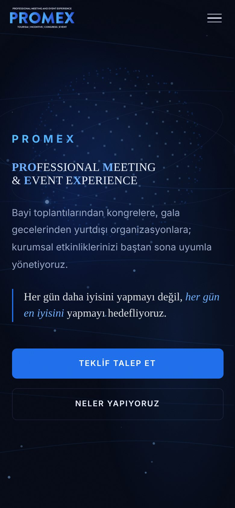
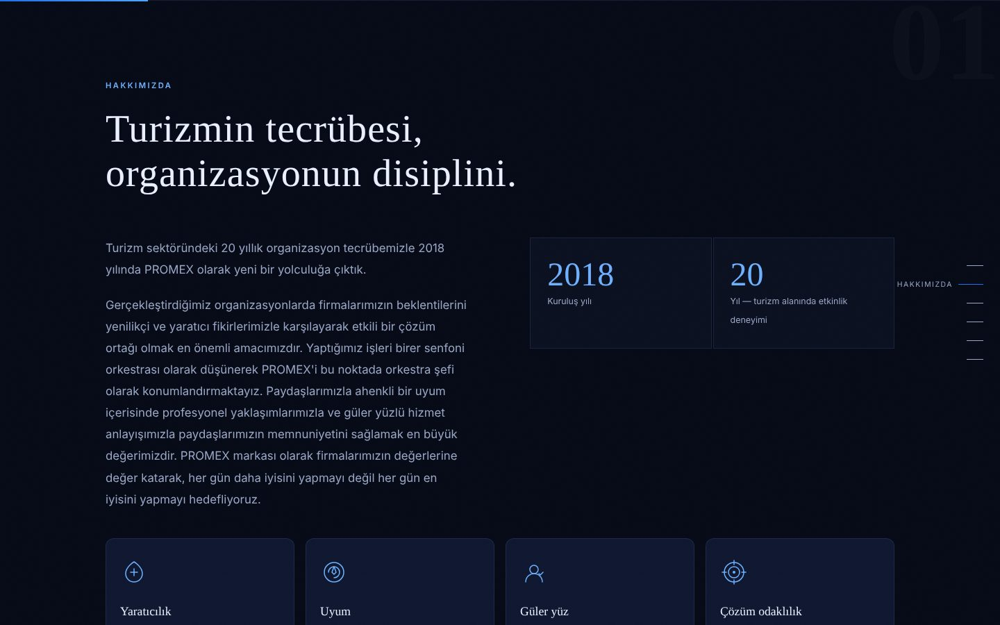
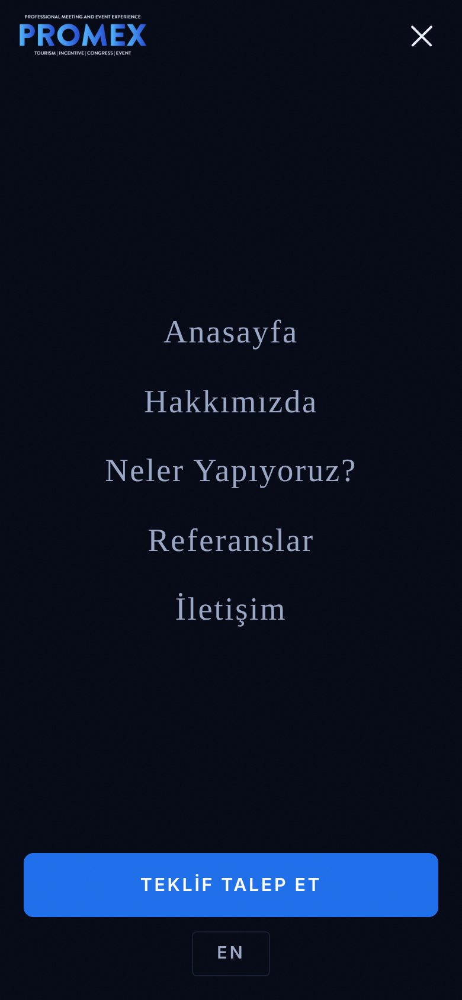

# PROMEX Turizm Organizasyon: Kurumsal Web Sitesi

Toplantı, kongre ve etkinlik (DMC) hizmetleri sunan PROMEX Turizm Organizasyon için sıfırdan tasarlayıp kodladığım, iki dilli (Türkçe / İngilizce) kurumsal web sitesi.

**Canlı site:** [promexturkey.com](https://www.promexturkey.com/)

> Bu depo, çalışmamı göstermek amacıyla paylaşılmıştır. Fotoğraflar, logolar ve referans görselleri müşteriye ve üçüncü kişilere aittir, bu yüzden depoya **dahil edilmemiştir** (`assets/` klasörü yoktur). Depoyu olduğu gibi çalıştırırsanız görseller eksik görünür.

## Ekran görüntüleri

| Masaüstü | Mobil |
|---|---|
|  |  |
|  |  |

## Özellikler

- **İki dilli yapı:** Türkçe ana site ve `en/` altında İngilizce sürüm, ana sayfada dil geçişi
- **Hizmet sayfaları:** Bayi toplantıları, kongre ve sempozyum, ürün lansmanı, eğitim ve motivasyon, gala ve kurumsal davetler, DMC için ayrı sayfalar
- **Animasyonlar:** GSAP ve ScrollTrigger ile kaydırmaya duyarlı geçişler, Lenis ile yumuşak kaydırma
- **Hero bölümü:** Canvas ile çizilen dönen dünya küresi
- **Mobil uyum:** Tam ekran mobil menü, açılır/kapanır hizmet kartları (accordion)
- **Sürüklenebilir bantlar:** Kayan yazı bandı ve referans logo bandı fare ve dokunmatikle sürüklenebilir
- **Teklif formu:** PHP ile çalışan form, e-postayı SMTP üzerinden gönderir, ziyaretçi adresi yanıt (Reply-To) olarak ayarlanır
- **SEO ve yasal:** `sitemap.xml`, `robots.txt`, KVKK aydınlatma metni sayfası, yönlendirme kuralları (`.htaccess`)

## Kullanılan teknolojiler

HTML · CSS · JavaScript (vanilla) · GSAP 3 + ScrollTrigger · Lenis · PHP · Apache (`.htaccess`)

Çerçeve ya da derleme adımı yoktur. Sayfalar statik dosyalardır.

## Klasör yapısı

```
.
├── index.html              # Türkçe ana sayfa
├── en/                     # İngilizce sürüm (ana sayfa + hizmet sayfaları)
├── hizmetler/              # Türkçe hizmet sayfaları
├── css/style.css           # Tüm stiller
├── js/main.js              # Animasyonlar, menü, bantlar, form
├── iletisim.php            # Teklif formu işleyicisi (SMTP)
├── promex-ayar-ornek.php   # SMTP ayar şablonu (gerçek parola içermez)
├── kvkk.html · 404.html · robots.txt · sitemap.xml · .htaccess
└── ekran-goruntuleri/      # README'deki görseller
```

## E-posta ayarı hakkında

Form işleyicisi, SMTP bilgilerini sitenin dışındaki bir dosyadan okur (`public_html`'in bir üstündeki `promex-ayar.php`). Parola bu depoda ya da web'den erişilebilen bir klasörde bulunmaz. Şablon için `promex-ayar-ornek.php` dosyasına bakın.

## Lisans ve kullanım

Kodlar inceleme amacıyla görünür durumdadır. İzin alınmadan kopyalanıp başka bir projede kullanılamaz. Tüm hakları saklıdır.

---

Tasarım ve geliştirme: **Semanur Çevirme**
